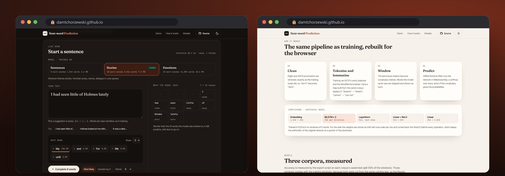
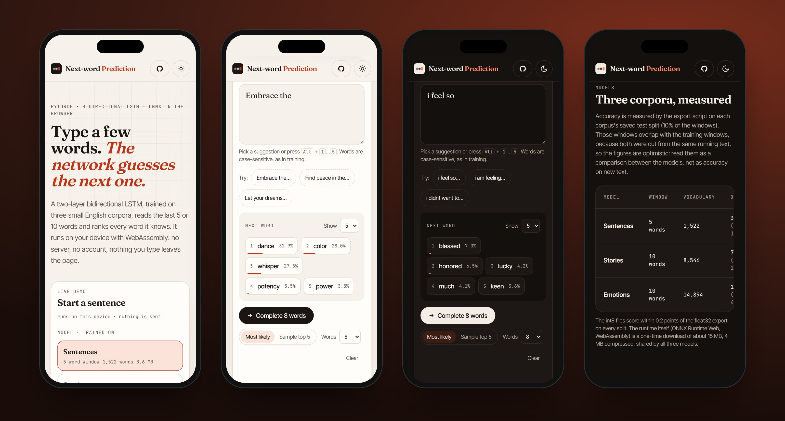
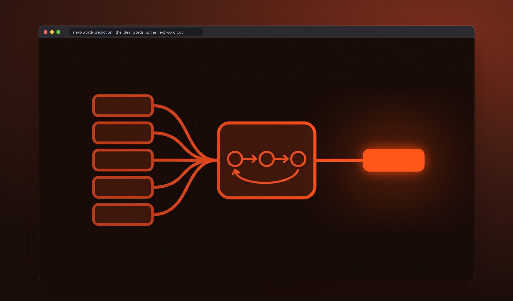
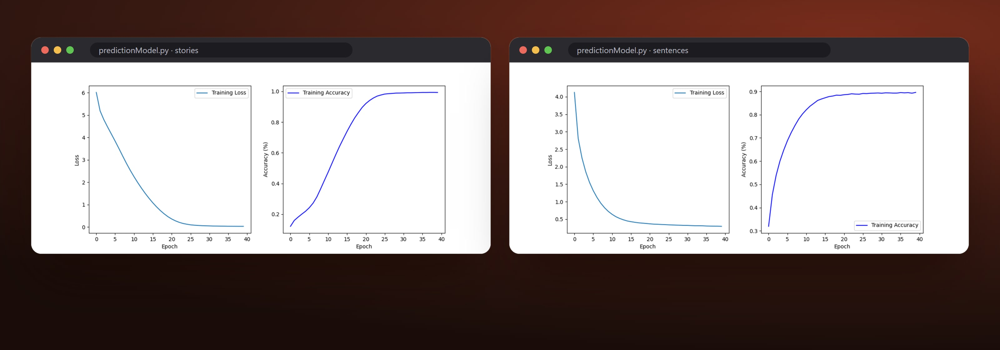
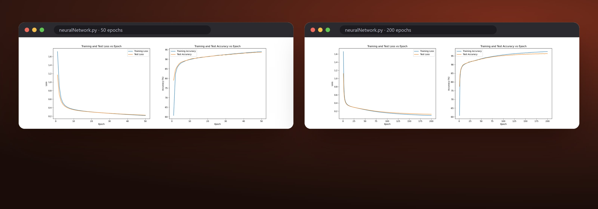

<p align="center">
  <picture>
    <source media="(prefers-color-scheme: dark)" srcset="docs/images/banner-dark.png">
    
  </picture>
</p>

<p align="center">
  
</p>

## About

<a href="https://damtchorzewski.github.io/next-word-prediction/"></a>

**next-word-prediction** is a next-word prediction model written in PyTorch: given a sequence of 5 or 10 words, a
bidirectional LSTM predicts the word that follows. The trained models are exported to ONNX and run **live in the
browser** in a Vue 3 demo on GitHub Pages, with no server. Around it are the warm-ups that led to it: tensors, a data
loader and a small fully connected network on MNIST.

- **Live demo (`web/`).** Type and get the top 3, 5 or 8 next words as chips with their probabilities (click or
  `Alt`+`1`…`8`); a half-typed word filters the suggestions by prefix. Pick the model (stories, sentences, emotions),
  let it complete 4, 8 or 16 words (the most likely word or a draw from the top 5) and watch the input window: which
  tokens the LSTM gets, with their vocabulary indices, the words rewritten as in training and the words it skips.
  The model (3.6 to 10.6 MB) and ONNX Runtime Web (WebAssembly, about 3.9 MB compressed) download only when the text
  field is first used. Light and dark theme, keyboard and screen-reader friendly, checked with axe for WCAG 2.2 AA.
- **Lemmatisation in the browser.** Training removed digits and punctuation, tokenised with NLTK `word_tokenize` and
  lemmatised every token with the WordNet lemmatiser (noun forms: `dreams` → `dream`, `cannot` → `can not`). The demo
  replays this with `forms.json`, a map built by the export script from the same corpus: every word of the corpus that
  training changed, with the tokens it became. An unseen plural falls back to its singular when that is in the
  vocabulary. The suggestions are therefore lemmas, as the model learnt them, and the window shows every rewrite. The
  models were not retrained.
- **Export (`pyTorch/advancedTools/exportWeb.py`).** Each `.pth` with a vocabulary becomes `model.onnx` (opset 17,
  dynamic batch and window length) with weight-only int8 quantisation: the weights are stored as int8 with one scale
  per row and turned back into float32 by `DequantizeLinear`, so every operator, the LSTM included, still computes in
  float32, at a quarter of the float32 file size. The script also writes `vocab.json`, `forms.json` and `meta.json`
  with the measured accuracy (below).
- **Next-word prediction (`pyTorch/advancedTools/`).** A two-layer bidirectional LSTM with an embedding and layer
  normalisation (`ComplexRNN`), trained on word sequences of length 5 or 10. The text is tokenised and lemmatised
  with NLTK (`wordPreprocessing.py`) and read from `advancedTools/base/` (Sherlock Holmes stories, a collection of
  sentences, an emotion data set). 256-dimensional embeddings and hidden state, 40 epochs, learning rate 0.0001 by
  default. `trainedModel.py` prints the sentence, the target word and the model's prediction.
- **Four trained models** are in `pyTorch/path/` (one per text: stories, sentences, emotions and a
  `next_word_prediction_data_base.txt` whose text and vocabulary are not in the repository, so it is not in the demo),
  each with its training plot.
- **MNIST network (`neuralNetwork.py`).** A 784-64-10 network (`SimpleNet`) with cross-entropy loss, SGD with
  momentum and weight decay, early stopping (`patience`), plots of loss and accuracy per epoch, and saving and
  loading of the weights.
- **Warm-ups.** `tensorBasics.py` (tensors, addition, element-wise multiplication, transpose) and `dataLoaderMnist.py`
  (MNIST with a `DataLoader`, normalisation with mean 0.1307 and std 0.3081, batches of 64).

Measured by `exportWeb.py` on each corpus's saved test split with the int8 ONNX files (the float32 export differs by at
most 0.2 points):

| Model     | Window | Vocabulary | `model.onnx` (float32) | Test windows | Top-1 | Top-5 |
| --------- | ------ | ---------- | ---------------------- | ------------ | ----- | ----- |
| Sentences | 5      | 1,522      | 3.6 MB (14.2 MB)       | 3,354        | 66.7% | 81.9% |
| Stories   | 10     | 8,546      | 7.3 MB (28.6 MB)       | 11,467       | 12.5% | 26.2% |
| Emotions  | 10     | 14,894     | 10.6 MB (41.6 MB)      | 76,716       | 12.6% | 25.5% |

> **Status:** the test windows were cut from the same running text as the training windows and overlap with them, so
> these figures are optimistic and are not accuracy on new text. The `data/` folder (MNIST) is downloaded on first run
> and is not in the repository; the sample prediction code in `predictionModel.py` uses CUDA.

## Tech stack

|               |                                                                                                                    |
| ------------- | ------------------------------------------------------------------------------------------------------------------ |
| Stack         | Python 3 scripts (training, export) and a Vue 3 + TypeScript app built with Vite (the demo)                        |
| Deep learning | PyTorch and torchvision, matplotlib for the plots; ONNX and onnxruntime for the export                             |
| Language      | NLTK (tokenising, lemmatising), tqdm, scikit-learn (train / test split)                                            |
| UI            | Vue 3 (Composition API), Tailwind CSS 4, Fraunces, Inter Tight and JetBrains Mono (Fontsource)                     |
| Inference     | ONNX Runtime Web 1.31 in the browser, WebAssembly, one thread                                                      |
| Data          | text corpora in `pyTorch/advancedTools/base/`; exported models in `web/public/models/`; MNIST in `data/` (ignored) |
| Tests         | Vitest (the preprocessing); Playwright with axe (prediction, lemmas, model switch, WCAG 2.2 AA, desktop and phone) |
| Hosting       | GitHub Pages, deployed by GitHub Actions from `main`                                                               |

Comments in the Python scripts are a mix of English and Polish; the demo, the README, commits and branches are in
English.

## Screenshots

On the left the stories model in the dark theme, on the right how it works; then the demo on phones (home, the
sentences model, the emotions model, the model table).

<p align="center">
  
</p>
<p align="center">
  
</p>

The idea in one picture (a supplied illustration, not output of the code), then the training plots the scripts saved in
`pyTorch/path/`: the next-word model on the stories and on the sentences, and the MNIST network after 50 and 200 epochs.

<p align="center">
  
</p>
<p align="center">
  
</p>
<p align="center">
  
</p>

## Quick start

```bash
git clone https://github.com/DamTchorzewski/next-word-prediction.git
cd next-word-prediction

# the web demo
pnpm install
pnpm dev                            # http://localhost:5173/next-word-prediction/

# the Python scripts
pip install torch torchvision matplotlib scikit-learn nltk tqdm
python pyTorch/tensorBasics.py
python pyTorch/neuralNetwork.py     # downloads MNIST to ./data
cd pyTorch/advancedTools && python predictionModel.py

# re-export the models for the demo (from the repository root)
pip install torch onnx onnxruntime onnxscript nltk numpy
python pyTorch/advancedTools/exportWeb.py
```

Requirements: Node 22 (`.nvmrc`) and pnpm 11 (`packageManager`) for the demo; Python 3 for the scripts. Run the
scripts from the **repository root** (`./data/` is relative to it). The next-word model is trained from
`pyTorch/advancedTools/`; it chooses its text with `model_file_name` in `predictionModel.py` (a file name from
`base/`), and the sample prediction code needs a CUDA GPU. The export runs on the CPU.

## Scripts

| Command                                                   | What it does                                                             |
| --------------------------------------------------------- | ------------------------------------------------------------------------ |
| `pnpm dev`                                                | the demo with hot reload                                                 |
| `pnpm build` / `pnpm preview`                             | build the demo to `dist/` and serve that build                           |
| `pnpm check`                                              | format check, lint (with the Vue accessibility rules), types, unit tests |
| `pnpm test` / `pnpm test:e2e`                             | Vitest; Playwright against the production build (`pnpm build` first)     |
| `pnpm health`                                             | check the live demo (`SITE_URL=...`), run after every deploy             |
| `python pyTorch/advancedTools/exportWeb.py`               | export the models, vocabularies and forms to `web/public/models/`        |
| `python pyTorch/tensorBasics.py`                          | tensor addition, multiplication, transpose                               |
| `python pyTorch/dataLoaderMnist.py`                       | MNIST data loader with normalisation                                     |
| `python pyTorch/neuralNetwork.py`                         | train, plot and save the MNIST network                                   |
| `python predictionModel.py` (in `pyTorch/advancedTools/`) | prepare the text, train and test the next-word model                     |

## Configuration

None: no environment variables, keys or `.env` file. The demo's base path (`/next-word-prediction/`) is in
`vite.config.ts`; the corpora and their windows for the export are the `CORPORA` list in `exportWeb.py`. Training
settings sit at the top of the scripts: `model_file_name`, `embedding_dim`, `hidden_size`, `num_epochs` and
`learning_rate` in `predictionModel.py`; `epochs` and `patience` in `neuralNetwork.py`.

## Structure

```
web/index.html, web/src/main.ts                 the demo's entry
web/src/App.vue, web/src/components/            ★ the page: demo panel, suggestions, window, how it works, models
web/src/composables/usePredictor.ts             ★ loading the models, prediction, autocomplete
web/src/lib/preprocess.ts                       ★ the training pipeline in TypeScript (clean, forms, window, top-k)
web/src/lib/model.ts                            ONNX Runtime Web, loaded on demand
web/src/lib/corpora.ts                          names, examples and measured figures of the models
web/public/models/<model>/                      model.onnx, vocab.json, forms.json, meta.json (generated)
tests/e2e/                                      Playwright and axe
scripts/health.mjs                              smoke check of the live demo
pyTorch/tensorBasics.py, dataLoaderMnist.py     warm-ups
pyTorch/neuralNetwork.py                        the MNIST network
pyTorch/advancedTools/predictionModel.py        ★ next-word model: text, training, prediction
pyTorch/advancedTools/exportWeb.py              ★ export to ONNX for the demo
pyTorch/advancedTools/rnnModel.py               the bidirectional LSTM
pyTorch/advancedTools/trainedModel.py           prediction with a trained model
pyTorch/advancedTools/wordPreprocessing.py      tokenising, lemmatising, word pairs
pyTorch/advancedTools/base/                     the text corpora
pyTorch/advancedTools/wordPairs/                generated vocabularies and word-pair files
pyTorch/path/                                   plots and saved models
data/                                           MNIST, git-ignored, downloaded on first run
docs/                                           documentation; docs/images/ holds the README images (generated)
```

## Branches and workflows

Shared standards from `reops/standards`: `main` ≤ `develop` ≤ a working branch `<type>/<topic>`, work PRs into
`develop`, release PRs into `main`, Conventional Commits in English (commitlint and lint-staged in husky hooks). One
workflow, `.github/workflows/deploy.yml` (level 1, a static site with a build): a push to `develop` runs `pnpm check`
and builds; a push to `main` also publishes `dist/` to GitHub Pages and runs `pnpm health`. A change to the
documentation or to `pyTorch/` alone starts nothing.

**Departures from the standards (and why):**

- **e2e runs on the laptop, not in CI:** the workflow is level 1 (check and build); `pnpm test:e2e` loads all three
  models and is run before every PR.
- **Generated files are committed:** the exported models in `web/public/models/` (about 21 MB, needed by the Pages
  build, re-exported by hand), the word-pair files (about 90 MB), four trained models (`*.pth`, about 100 MB) and
  `__pycache__`. `.gitignore` ignores `*.pth` and `__pycache__`, but files already tracked stay in the tree and in the
  history until the owner removes them (and rewrites history or moves the models to Git LFS).
- **The README logo is a wordmark** (the project has none); the demo's mark is three word tiles drawn in
  `LogoMark.vue`.

## Documentation

| Document                                 | Covers                                                    |
| ---------------------------------------- | --------------------------------------------------------- |
| [docs/repository.md](docs/repository.md) | GitHub description, website and topics, Pages, the rename |

The README images (`docs/images/`) are regenerated with `tools/readme-images` (profile `next-word-prediction`): shots of
the demo (a local `pnpm preview` through `SITE_URL`, or the live site) and the plots in `pyTorch/path/`; the working
shots go to `.scratch/`.

---

<p align="center"><a href="https://damreboot.pl"><picture><source media="(prefers-color-scheme: dark)" srcset="docs/images/damreboot/company-dark.svg"></picture></a><a href="https://www.linkedin.com/in/damian-tchorzewski-3b2388275/"><picture><source media="(prefers-color-scheme: dark)" srcset="docs/images/damreboot/linkedin-dark.svg"></picture></a><a href="mailto:damianchabracki@gmail.com"><picture><source media="(prefers-color-scheme: dark)" srcset="docs/images/damreboot/email-dark.svg"></picture></a></p>

<p align="center">
  <picture><source media="(prefers-color-scheme: dark)" srcset="docs/images/damreboot/engineered-dark.svg"></picture> Engineered by <b>Damian Chabracki</b> (DamReboot IT)
</p>
